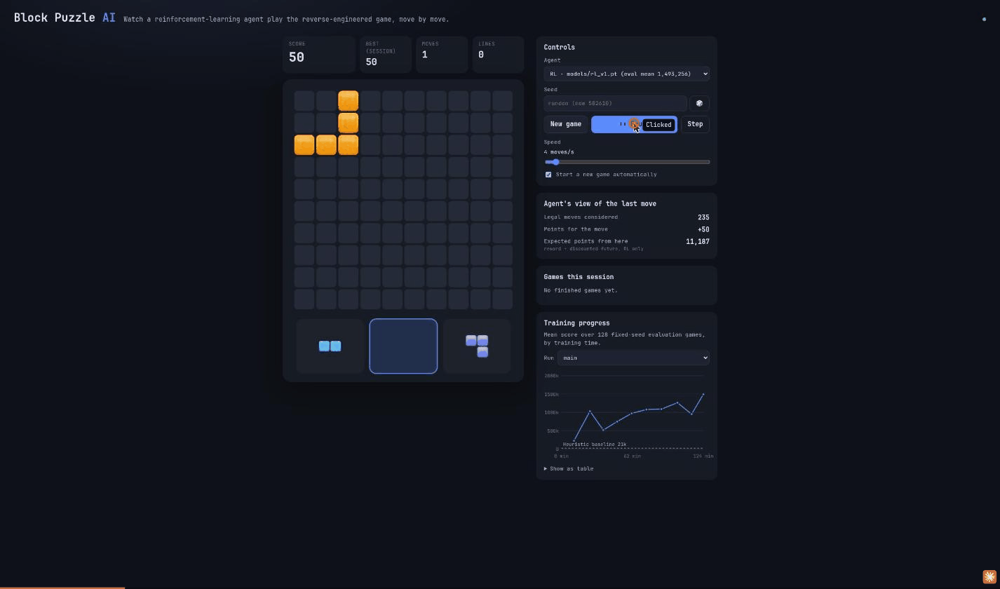

# Block Puzzle AI

A reinforcement-learning agent for the Android game **Block Puzzle** (`game.puzzle.blockpuzzle` v6.1).
The game rules were reverse-engineered from the shipped APK, re-implemented as a fast simulator,
and used to train an agent that scores about **70× more than a hand-tuned heuristic**.
With a danger-gated lookahead search on top, it averages **6.0 million** points per game, and one game reached **21.7 million**.
A browser app lets you watch it play live.



## Results

All agents were evaluated on the same 128 fixed seeds, with games capped at 20,000 moves:

| Agent | Mean score | Median | Max | Moves / game | Points / move |
|---|---:|---:|---:|---:|---:|
| Random legal moves | 1,012 | 900 | 2,050 | 24 | 42 |
| Heuristic (greedy, tuned) | 20,879 | 15,515 | 87,560 | 279 | 75 |
| **RL `models/rl_v1.pt`** | **1,493,256** | **1,854,600** | **2,206,540** | 13,782 | **108** |

- **Cap:** 54 of the 128 RL games were still alive at the 20,000-move cap. The table therefore *understates* the agent.
- **Long run:** with the cap raised to 200,000 moves, all 64 games ended in a real game over. Mean **2.6M**, median 1.8M. Best game: 11,750,010 points in 108,511 moves.
- **Lookahead search** (`--search-below 110 --top-k 8`, same 64 long games):
  - Mean **6.0M** (2.3×; +3.4M, bootstrap 95% CI [+2.1M, +4.7M]), median 4.4M.
  - Moves per game over rose from 24k to 56k.
  - **High score: 21,739,880 points.** That game was still alive at the 200,000-move cap.
  - See [`docs/RESULTS.md`](docs/RESULTS.md).
- **Scoring efficiency:** the agent scores more points per move than the heuristic because it deliberately sets up multi-line clears. The game pays `50·L·(L+1)` for `L` simultaneous lines.

## How it works

1. **Reverse engineering** ([`docs/REVERSE_ENGINEERING.md`](docs/REVERSE_ENGINEERING.md), [`docs/RULES.md`](docs/RULES.md))
   - The game is Cocos2d-x C++, with all rules in `lib/arm64-v8a/libMyGame.so`. REA was used for the artifact inventory and extraction, and `llvm-objdump` for AArch64 disassembly.
   - The piece table was extracted by **emulating the game's own `PendingTileManager::init()`** in Unicorn ([`re/extract_pieces.py`](re/extract_pieces.py)).
   - Placement, line detection, game over and scoring were checked by emulating the shipped functions against a Python model, with 0 mismatches over 165k cases ([`re/verify_rules.py`](re/verify_rules.py)).
2. **Simulator** ([`game.py`](src/block_puzzle_ai/game.py), [`batch_env.py`](src/block_puzzle_ai/batch_env.py))
   - `game.py` is a readable bitboard reference implementation.
   - `batch_env.py` is a vectorized PyTorch twin that evaluates all 3×100 candidate moves of hundreds of games at once on the GPU. Tests check that both behave identically.
3. **Agent** ([`train.py`](src/block_puzzle_ai/train.py))
   - It learns an *after-state value* `V(board after the move + remaining pieces)` with a small residual CNN.
   - It plays greedily over all legal moves by `reward + γ·V(after-state)`.
   - It is trained by self-play on 512 parallel games with Watkins Q(λ) targets (γ = 0.99, λ = 0.8) and ε-greedy exploration.
   - The input features include fit maps that show where each remaining piece could still go.
4. **Lookahead search** ([`agents.py`](src/block_puzzle_ai/agents.py), `LookaheadAgent`)
   - It runs only where the best 1-ply Q drops below 110, which is about 2% of moves. Deaths almost always show up there 1–3 moves ahead.
   - There it re-scores the 8 best moves by an expectimax over the next spawned piece, using the exact spawn probabilities.
   - It needs no retraining.

## Usage

```bash
uv sync

# watch the AI play (http://127.0.0.1:8000); pick "RL + lookahead" to watch the search
uv run python -m block_puzzle_ai.viewer

# evaluate an agent: random | heuristic | path/to/checkpoint.pt
uv run python -m block_puzzle_ai.evaluate --agent models/rl_v1.pt --games 128 --max-moves 20000
# ...with lookahead search where it senses danger (several times slower)
uv run python -m block_puzzle_ai.evaluate --agent models/rl_v1.pt --search-below 110 --top-k 8

# train (metrics in runs/<name>/metrics.jsonl, checkpoints best.pt / latest.pt)
uv run python -m block_puzzle_ai.train --minutes 120 --out runs/main
uv run python -m block_puzzle_ai.train --minutes 60 --init models/rl_v1.pt --out runs/finetune

# tests
uv run pytest
```

### Reverse-engineering tools (APKs are not part of this repo)

Extract `lib/arm64-v8a/libMyGame.so` from `split_config.arm64_v8a.apk`, then:

```bash
uv run python re/extract_pieces.py path/to/libMyGame.so src/block_puzzle_ai/data/pieces.json
uv run python re/verify_rules.py   path/to/libMyGame.so
```

## Recovered rules in short

- **Board:** 10×10.
- **Pieces:**
  - Three pieces are always offered, from 12 shape groups with fixed rotations; the player cannot rotate them.
  - After each placement the tray slots shift left, and a new piece is spawned into the last slot.
  - Larger shapes (T, U, plus) unlock at a score of about 3,000.
  - After a hard piece (3×3, U or plus), the next three spawns are limited to the easier shapes.
- **Clears:** full rows and full columns clear at the same time, with no gravity.
- **Score:** `10 × cells placed + 50·L·(L+1)`, where `L` is the number of rows plus columns completed. There are no combo bonuses.
- **Game over:** when none of the three offered pieces fits anywhere.

## Project layout

```
re/                     AArch64 emulation harness + extraction/verification scripts
docs/                   RE notes, rules spec, results
src/block_puzzle_ai/
  pieces.py, data/      recovered piece table
  game.py               reference simulator
  batch_env.py          vectorized GPU simulator
  env.py                gymnasium-style single-game env (Discrete(300) + action mask)
  features.py, model.py after-state encoding and value network
  agents.py             random / heuristic / RL agents
  train.py, evaluate.py training and evaluation CLIs
  viewer/               FastAPI + canvas web viewer
models/                 released checkpoint(s) + baseline numbers
tests/
```

The original APKs and anything extracted from them are deliberately excluded from version control.
